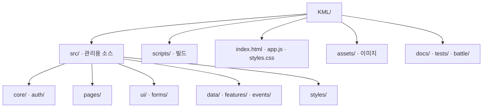

# KML 코드 구조

KML은 Supabase에 저장된 성충·라인·유충 기록을 읽는 정적 웹앱입니다. 관리용 소스를 기능별로 분리하고 배포 시 합칩니다. 실제 데이터는 계속 데이터베이스에 저장되며, 소스 폴더와는 별개입니다.

## 디렉터리 트리



| 경로 | 담당 기능 |
| --- | --- |
| `src/core/state.js` | 앱 상태, 설정, 기본 사진, 공통 도우미 |
| `src/core/lifecycle.js` | 재진입, 화면 복귀, 연동 데이터 갱신, 시작 |
| `src/auth/session.js` | 로그인, 접근 권한, 세션 초기화 |
| `src/pages/home.js` | 홈과 MY PAGE |
| `src/pages/adult-list.js` | 성충 목록과 필터 |
| `src/pages/adult-detail.js` | 성충 화면, 상세, 계통도 |
| `src/pages/larva-detail.js` | 유충 개체 상세, 사육 기록과 계통도 |
| `src/pages/lines.js` | 라인 목록, 라인 상세, 유충 표 |
| `src/pages/account.js` | 회원, 프로필, 데이터 관리 화면 |
| `src/ui/icons.js` | 아이콘, 상태와 성별 표시 |
| `src/ui/navigation.js` | 주소 이동, 사이드바, 상단 바 |
| `src/ui/modal-frame.js` | 입력창 공통 틀과 선택 항목 |
| `src/ui/year-picker.js` | 연도 선택, 증감 버튼, 날짜 유효성 |
| `src/ui/dialog.js` | 입력창 표시, 스크롤과 화면 높이 처리 |
| `src/forms/specimens.js` | 성충·라인·소유자 변경 입력창, 누대수 계산 |
| `src/data/records.js` | 데이터 읽기, 저장, 표시 데이터 변환 |
| `src/data/export.js` | 유충 CSV 내보내기 |
| `src/features/beetlelog-import.js` | BeetleLog 선택 가져오기와 유충 연결 |
| `src/features/specimen-labels.js` | 성충·유충 라벨, 초안, 계통도 전환과 PNG 저장 |
| `assets/label-template.png` | Labeling 저장소의 원본 라벨지 |
| `src/styles/specimen-labels.css` | 라벨 패널과 모바일 입력창 |
| `src/events/actions.js` | 클릭, 생성, 삭제 등 버튼 동작 |
| `src/events/input-photos.js` | 입력값 변경, 연도·날짜 동기화, 사진 처리 |
| `src/events/forms.js` | 입력창 저장, 필터, 키보드와 주소 변경 |
| `src/styles/` | 기본·반응형·계정·가져오기·입력창·홈·모바일·연도 CSS |
| `scripts/sources.json` | 소스를 합치는 순서 |
| `scripts/build.mjs` | 외부 패키지 없이 JS/CSS 묶기와 일치 검사 |
| `app.js`, `styles.css` | 자동 생성된 배포 파일 |
| `tests/kml-import-ui.cjs` | 가져오기, 유충 표와 CSV 회귀 검사 |
| `tests/year-picker.cjs` | 연도 범위, 날짜 보존, 빈 날짜, 윤년 검사 |
| `tests/pedigree-ui.cjs` | 조부모까지의 계통도, 금색 격자와 회원 사진 |
| `tests/specimen-labels.cjs` | 라벨 매핑, 초안 격리, 원본 기록 보존과 유충 상세 |
| `.github/workflows/pages.yml` | 빌드 결과와 검사 통과 후 Pages 배포 |
| `docs/` | 설정, SQL 변경 이력, 구조 설명 |
| `battle/index.html`, `battle/admin.html` | 기존 배틀 행사 화면과 관리자 화면 |
| `battle/ibb/index.html`, `battle/ibb/admin.html` | 기존 IBB 행사 화면과 관리자 화면 |
| `battle/` 내부 이미지 | 행사 포스터와 이미지 자산 |

## 수정과 배포

`app.js`와 `styles.css`를 직접 수정하지 않고 `src/` 아래 담당 파일을 수정합니다. Node.js 22 이상에서 프로젝트 루트 기준으로 실행합니다.

```sh
node scripts/build.mjs
node scripts/build.mjs --check
node tests/kml-import-ui.cjs
node tests/year-picker.cjs
node tests/pedigree-ui.cjs
node tests/specimen-labels.cjs
```

소스와 생성된 두 파일을 함께 커밋합니다. 새 파일을 만들면 `scripts/sources.json`에도 추가합니다. 배포 검사에서 생성 파일이 소스와 다르거나 회귀 검사가 실패하면 배포를 중단합니다.

기존 함수와 상태의 공유 범위를 유지하도록 순서대로 하나의 함수 범위에 합치는 방식입니다. 브라우저가 소스 파일을 개별로 불러오지 않습니다. CSS도 기존 순서대로 합쳐 기존 덮어쓰기 규칙을 유지합니다. 런타임 모듈 로더나 추가 라이브러리는 사용하지 않습니다.

## 연도 입력 동작

- 신규 입력의 연도는 기기의 당해 연도입니다. 2026년에는 2021–2031년 11개가 표시됩니다.
- 드롭다운 또는 ▲/▼ 버튼으로 변경합니다. 버튼은 한 해씩 움직이고 범위 끝에서 비활성화됩니다.
- 라인 시즌, 성충 우화일, 소유자 변경일에 적용합니다. 성충의 월·일과 기존 날짜는 보존합니다.
- 선택 사항인 우화일은 연도만 표시되어 있어도 월·일을 선택하기 전까지 빈 값으로 저장됩니다.
- 2월 29일에서 평년으로 바꾸면 유효한 일을 다시 선택해야 합니다. 다른 날짜로 몰래 바꾸지 않습니다.
- 범위 밖에 있는 기존 기록은 해당 연도만 ‘기존 값’으로 추가하여 보존합니다. 이 값에서는 증감 버튼을 잠그며, 목록에서 범위 안의 연도를 선택하면 증감할 수 있습니다.
- 목록의 ‘전체 연도’ 필터는 과거 기록을 계속 찾을 수 있도록 유지합니다.
- 터치 기기에서는 버튼을 가로로 배치해 누를 영역을 확보합니다. 선택값 변경 시 입력창 전체를 다시 그리지 않습니다.

## 로딩과 데이터 증가 점검

2026-10-23 변경 전후의 실제 파일과 로컬 gzip 압축 결과입니다. gzip은 비교용이며 서버 전송 방식이나 아이폰 로딩 시간을 측정한 수치는 아닙니다.

| 항목 | 변경 전 | 변경 후 |
| --- | ---: | ---: |
| 앱 JS 파일 요청 | 1 | 1 |
| 앱 CSS 파일 요청 | 1 | 1 |
| JS 원본 | 84,643 bytes | 89,106 bytes |
| CSS 원본 | 38,345 bytes | 39,454 bytes |
| JS gzip | 26,004 bytes | 27,436 bytes |
| CSS gzip | 9,586 bytes | 9,884 bytes |

연도·날짜 UI 추가를 포함한 전체 증가는 원본 합계 5,572 bytes, gzip 비교 합계 1,730 bytes입니다. 파일 분리는 배포 시 합쳐지므로 브라우저 요청 수나 모듈 실행 단계를 늘리지 않습니다. 외부 글꼴, Supabase SDK, 이미지 요청 구성도 그대로입니다. 생성 결과 일치, JS 구문, 기존 가져오기 검사와 새 연도 검사를 통과했습니다. 아이폰 실기기의 화면·스크롤·로딩 시간은 별도 확인이 필요합니다.

데이터가 커질 때 별도로 주의할 지점은 `loadRemote()`와 `refreshLinkedRecords()`입니다. 현재 접근 가능한 6개 테이블을 전체 조회하고, 활성 화면에서 8초마다 다시 조회합니다. 데이터량과 네트워크에 따라 이 조회·비교·화면 갱신 비용이 커질 수 있습니다. 이번 소스 분리로 이 비용이 줄어들지는 않습니다. 데이터 규모에 맞춘 페이지별 조회, 페이지 나누기, 변경분 조회는 별도 데이터 로딩 개선 대상입니다.

## 개체 상세의 라벨과 계통도

성충 상세와 라인 표의 유충 번호에서 여는 상세는 라벨을 기본으로 표시합니다. 라벨·계통도 탭은 같은 패널을 전환하며 입력 폼 전체를 다시 만들지 않습니다. 계통도의 기호·체장은 21px, 라인·관리번호·브리더는 17px입니다.

`assets/label-template.png`와 캔버스 그리기 코드는 [Labeling](https://github.com/ljy5747/Labeling)에서 가져왔습니다. 원본 라벨 이미지는 수정하지 않았습니다. 참조한 `index.html` blob은 `3ad51995a7fb954fb215760449d9ca7406f226e3`, `template.png` blob은 `7dbbae831d208e5c207e1776a2d9672d816a46e7`입니다. 라벨 이미지와 Noto Serif KR 글꼴은 상세 화면에서만 불러옵니다.

유충의 KML 사육 기록을 우선 사용하고 원본 sourceData의 두폭·용화·우화 메타데이터를 보완합니다. 푸딩과 일반 병을 구분하여 병은 1~5병만 라벨에 표시하고, 전체 기록은 상세 아래 표에 유지합니다. 값 0도 출력합니다. 성충의 사육 이력을 임의로 만들지 않으며, 부모가 같은 출생 라인이 하나로 확정되지 않으면 성충 혈통을 사용합니다.

라벨 수정은 회원·개체별 메모리 초안이며 데이터베이스에 저장되지 않습니다. 새로고침하거나 로그아웃하면 초안이 사라집니다. PNG는 원본 크기 1444×1032로 저장하며 지원하는 모바일에서는 공유 메뉴를 사용합니다. 편집 중에는 자동 새로고침을 보류하고 이미지 저장 중 앱 복귀로 상세가 홈으로 바뀌지 않게 합니다. 아이폰 실기기의 공유 동작은 별도 확인 대상입니다.
